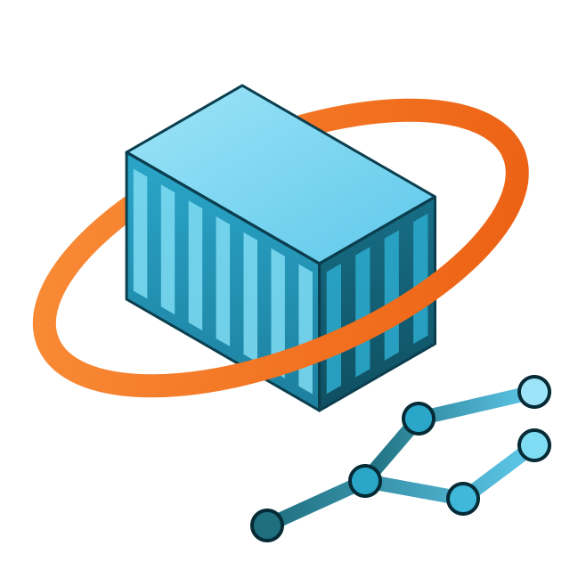
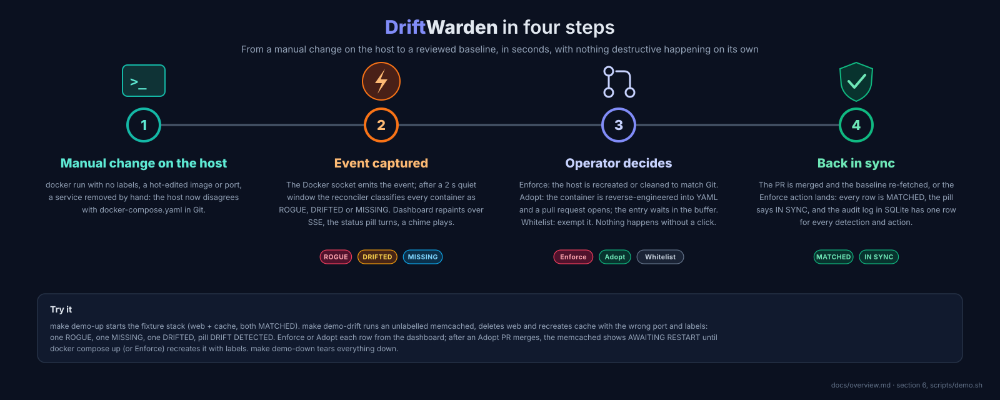
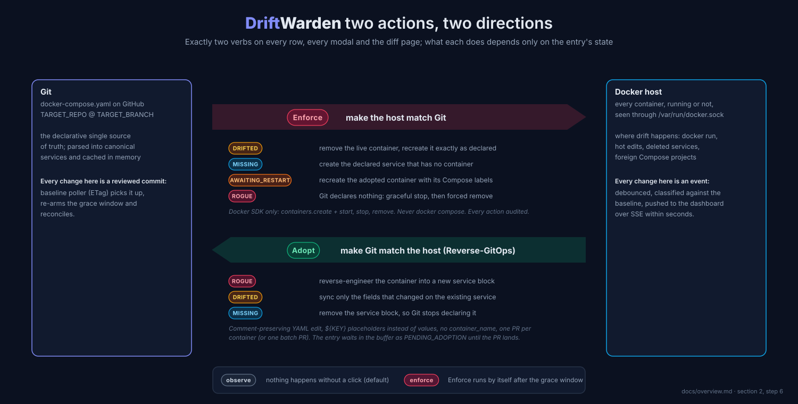
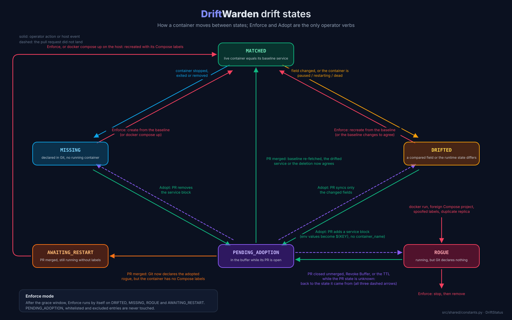
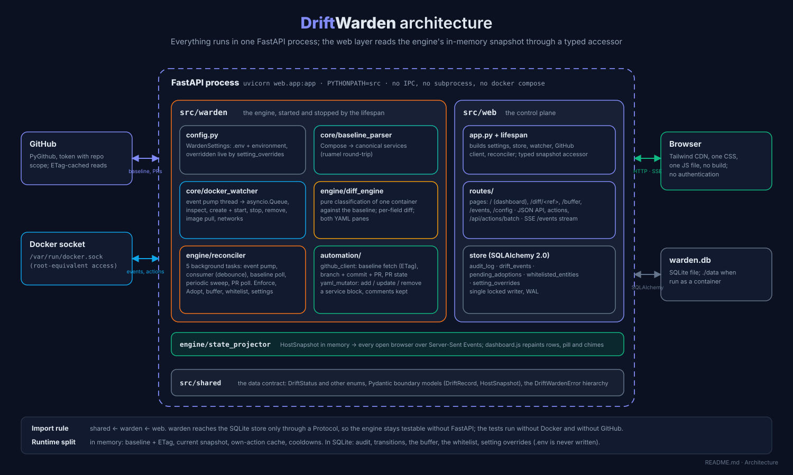

<p align="center">
  
</p>

# DriftWarden

DriftWarden is a lightweight GitOps guardrail and drift-remediation daemon for standalone Docker hosts. It treats a `docker-compose.yml` hosted on GitHub as the single declarative source of truth and continuously watches the host's Docker socket so live workloads never diverge from it silently.



## 🎯 What it does

Standalone Docker hosts drift when engineers bypass CI/CD with manual `docker run` commands or hot-edit live containers. DriftWarden closes the loop directly on the host:

* **Zero-trust host monitoring.** Every container on the host is in scope. Labels state intent, Git decides legitimacy: a container with correct Compose labels but no declared service is still `ROGUE`.
* **Real-time diff engine.** Docker events trigger a reconcile against the cached Git baseline; a structured per-field diff (`image`, `ports`, `environment`, `volumes`, `labels`, `restart`, `networks`) feeds the side-by-side viewer.
* **Two actions, two directions.**
  * **Enforce** makes the host match Git: it recreates a `DRIFTED`, `MISSING` or `AWAITING_RESTART` service from the baseline through the Docker SDK (`containers.run`, never `docker compose`), and stops and removes `ROGUE` containers.
  * **Adopt** makes Git match the host (Reverse-GitOps): it reverse-engineers the live container into a comment-preserving YAML mutation and opens a pull request on the infrastructure repository (or a PR that removes a `MISSING` service). Environment values are never committed; keys become `${KEY}` placeholders, and no `container_name` is written so Compose keeps control of naming and scaling.
* **State buffer.** Adopted containers stay `PENDING_ADOPTION`, exempt from enforcement, for as long as their pull request is open. A merge triggers a baseline re-fetch that clears the entry (the workload becomes `MATCHED`); closing the PR without merging returns it to `ROGUE` or `DRIFTED`.
* **Whitelist.** Operators can exempt a container or an entire foreign Compose project from the dashboard; the exemption lives in SQLite.



### Drift states



| State | Meaning |
| --- | --- |
| `MATCHED` | Running container matches its baseline service. |
| `DRIFTED` | Declared service exists but a compared field, or the runtime state (`paused`, `restarting`, `dead`), differs. |
| `MISSING` | Declared service has no container, or only a stopped / exited one. |
| `ROGUE` | Container not declared in Git: unlabelled, from another Compose project, spoofed labels, or a duplicate replica. |
| `PENDING_ADOPTION` | Buffered while an adoption pull request deploys. |
| `AWAITING_RESTART` | An adopted rogue container whose pull request has merged: Git now declares it, but it still runs without Compose labels. `docker compose up` (or Enforce) recreates it and it becomes `MATCHED`. |

### Evaluation order

1. **Hard exclusions**: DriftWarden's own container, name prefixes in `EXCLUDED_NAME_PREFIXES` (`warden-`, `driftwarden`, `k8s_`), and the label `warden.ignore=true`.
2. **Whitelist** (`whitelisted_entities` table): container id, container name or Compose project.
3. **Managed namespace** (`com.docker.compose.project` equal to the baseline's `name:`, or `COMPOSE_NAMESPACE` when `name:` is absent): map to a service by the `com.docker.compose.service` label, falling back to the `<project>-<service>-<n>` name pattern, then diff.
4. **Everything else** is `ROGUE`.

## 📚 Documentation

Longer, package-by-package guides live in [`docs/`](docs/):

* [`docs/overview.md`](docs/overview.md) — the project idea, the end-to-end workflow, dependencies, Makefile targets, scripts, tests and CI.
* [`docs/shared.md`](docs/shared.md) — `src/shared`: enums, exceptions and the Pydantic models that cross every boundary.
* [`docs/warden.md`](docs/warden.md) — `src/warden`: settings, Compose parsing, Docker access, classification rules, the reconcile loop, enforcement, adoption and the buffer.
* [`docs/web.md`](docs/web.md) — `src/web`: FastAPI app and lifespan, SQLite tables, pages, JSON API, the SSE stream and `dashboard.js`.

## 🏗️ Architecture



Everything runs inside one FastAPI process: the engine lives in the application lifespan, the web layer reads the in-memory snapshot through a typed accessor, and SQLite holds only what must survive a restart.

| Package | Role |
| --- | --- |
| `src/shared` | Pydantic boundary contracts, enums, exception hierarchy. |
| `src/warden/config.py` | `WardenSettings`, the single settings object. |
| `src/warden/core` | `baseline_parser` (Compose normalisation) and `docker_watcher` (events, inspect, kill, recreate). |
| `src/warden/engine` | `diff_engine` (pure classification), `reconciler` (loops, enforcement, actions), `state_projector` (snapshot + SSE). |
| `src/warden/automation` | `github_client` (baseline fetch, PR creation) and `yaml_mutator` (ruamel round-trip edits). |
| `src/web` | FastAPI app, SQLAlchemy 2.0 tables, routes, Jinja2 templates, vanilla JS. |

## ⚠️ Security warning: Docker socket access

DriftWarden binds to the host's Docker socket to subscribe to events and issue remediation commands. Socket access is equivalent to root on the host.

* Intended for standalone development and staging hosts.
* The control plane has **no authentication**. Keep port 8000 on an internal network or behind a reverse proxy with its own auth.
* The GitHub token needs the `repo` scope. If it is rejected the daemon still starts, in degraded observe mode, with a `BASELINE_UNAVAILABLE` banner.

## 🚀 Installation

Python 3.10+ and a local Docker engine are required.

```bash
git clone <your-repo-url>
cd DriftWarden
python -m venv venv
source venv/bin/activate      # Windows PowerShell: .\venv\Scripts\activate
make install-dev
cp .env.example .env          # then fill in GITHUB_PAT, TARGET_REPO, BASELINE_FILE_PATH ...
make start                    # http://localhost:8000
```

`make dev` runs `uvicorn web.app:app --app-dir src` with live reload; the import root is always `src` (`PYTHONPATH=src`). `make start` runs the same application inside a container (see below).

### Running as a container

```bash
make start   # docker build + docker run with the socket and ./data mounted, API_HOST=0.0.0.0
make stop
```

Equivalent by hand:

```bash
docker build -t driftwarden .
docker run -d --name driftwarden \
  -v /var/run/docker.sock:/var/run/docker.sock \
  -v "$PWD/data:/data" -e DATABASE_URL=sqlite:////data/warden.db \
  --env-file .env -e API_HOST=0.0.0.0 -p 8000:8000 driftwarden
```

The container detects its own id and excludes itself from evaluation.

## ⚙️ Configuration

All settings come from environment variables or `.env` (see `.env.example`).

| Variable | Default | Purpose |
| --- | --- | --- |
| `GITHUB_PAT`, `TARGET_REPO`, `TARGET_BRANCH`, `BASELINE_FILE_PATH` | — | Where the baseline lives and the token used to read it and open PRs. |
| `BASELINE_POLL_INTERVAL_SECONDS` | `30` | Poll interval; unchanged files return `304` via the cached ETag and cost no API quota. |
| `ALLOW_MOCK_BASELINE` | `false` | Load `tests/fixtures/docker-compose.test.yaml` instead of GitHub (adoption is disabled). |
| `COMPOSE_NAMESPACE` | — | Fallback project name when the baseline has no `name:`. |
| `WARDEN_MODE` | `observe` | `observe`: detect and wait for an operator. `enforce`: autonomous remediation after the startup pass. Read-only at runtime. |
| `DRIFT_DEBOUNCE_SECONDS` | `2` | Single global quiet window that coalesces Docker events into one reconcile. |
| `RECONCILE_SWEEP_INTERVAL_SECONDS` | `60` | Periodic full reconcile for events missed during reconnects. |
| `ENFORCEMENT_GRACE_SECONDS` | `30` | Enforcement is suppressed this long after every baseline change, and the baseline is re-fetched before any destructive action. |
| `ADOPTION_BUFFER_TTL_SECONDS` | `600` | Safety fallback only for buffer entries whose pull request state cannot be determined. |
| `EXCLUDED_NAME_PREFIXES` | `warden-,driftwarden,k8s_` | Containers never evaluated. |
| `DOCKER_SOCKET_PATH` / `DOCKER_BASE_URL` | `/var/run/docker.sock` / unset | Socket path, or an explicit `npipe://` / `tcp://` URL; otherwise `docker.from_env()`. |
| `DATABASE_URL` | `sqlite:///./warden.db` | Audit log, buffer, whitelist and drift events (WAL mode). |
| `WARDEN_HOSTNAME` | machine hostname | Friendly name shown in the UI and stamped on audit rows. |

## 🖥️ Control plane

| Page / endpoint | Purpose |
| --- | --- |
| `/` | Dashboard: counters, live table, Enforce / Adopt / Whitelist actions plus Enforce All / Adopt All, updated over Server-Sent Events. |
| `/diff/{name}` | Git baseline on the left, live observed state on the right, field-by-field table, action buttons. |
| `/events` | Drift transitions and the audit log. |
| `/buffer` | Active and historical pending adoptions. |
| `/config` | Editable runtime settings (overrides live in SQLite and win over the environment; switching to enforce requires typing `ENABLE AUTONOMOUS`), the raw baseline, exclusions and whitelist management. |
| `GET /api/state`, `GET /api/state/stream` | Snapshot JSON and the SSE stream. |
| `POST /api/actions/revert/{ref}`, `/kill/{ref}`, `/adopt/{ref}`, `/adopt-deletion/{ref}` | The Enforce button calls `revert` (recreate from Git) or `kill` (remove an undeclared container); the Adopt button calls `adopt` (write to Git) or `adopt-deletion` (remove a MISSING service from Git). Same code path as enforce mode. |
| `GET/POST /api/whitelist`, `DELETE /api/whitelist/{id}` | Exemptions. |
| `POST /api/actions/batch` | Enforce All / Adopt All over a scope (`all`, `rogue`, `drifted`, `missing`); Adopt All opens one consolidated pull request on a `warden/batch-adopt-*` branch. |
| `GET/PUT /api/settings` | Read and change runtime settings. |
| `POST /api/buffer/{id}/revoke` | Close the adoption pull request and evict every buffer entry that shares it. |
| `GET /api/audit`, `/api/events`, `/api/buffer`, `/api/health`, `POST /api/reconcile` | Data and a manual refresh. |

## 🛠️ Development workflow

* `make dev` runs the control plane and engine on the host with live reload.
* `make start` builds the image and runs DriftWarden as a container with `API_HOST=0.0.0.0`, the Docker socket mounted and the SQLite database kept in `./data/warden.db` (separate from the `./warden.db` that `make dev` uses through `.env`; point `DATABASE_URL` at `sqlite:///./data/warden.db` in `.env` if you want both to share one file); `make stop` removes the container, `make logs` follows it. The recipes run through `scripts/container.sh` in Git Bash, so they work from cmd.exe and PowerShell too.
* `make check` runs `ruff format --check`, `ruff check`, `mypy src/` (strict) and `pytest`. Run it before every commit.
* `make format`, `make lint`, `make typecheck`, `make test` run the individual tools.
* `make clean` wipes caches.
* `make reset-logs` runs `scripts/reset_logs.py`, which truncates the `drift_events` and `audit_log` tables in one transaction through the project's own engine.

Conventions: Python 3.10 syntax floor, `X | None` unions, Pydantic at every boundary and dataclasses inside the engine, Loguru only, `ruamel.yaml` round-trip only, PyGithub only (no subprocess git), no SPA frameworks.

## 🎬 Demo runners

```bash
make demo-up         # docker compose up the fixture stack (project infrastructure-test)
make demo-drift      # rogue memcached:alpine on 11211 (no env needed), delete web (MISSING), spoofed cache (DRIFTED)
make demo-down       # tear everything down
```

With the dashboard open, `make demo-drift` shows one `ROGUE`, one `MISSING` and one `DRIFTED` entry within the debounce window. Click **Enforce** on the cache to recreate it from Git, **Enforce** on `web` to spin it up, or **Adopt** on the rogue memcached to open a pull request on `TARGET_REPO`; once that PR merges the container shows as `AWAITING_RESTART` until Compose or Enforce recreates it with its labels.
