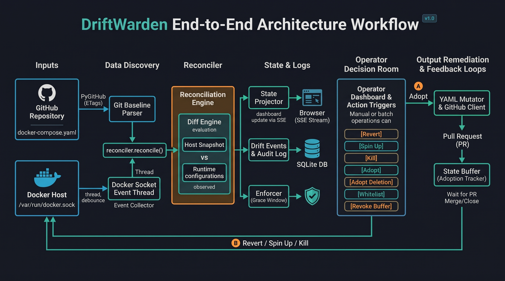

# DriftWarden — project overview

This page explains what DriftWarden is, how a change flows through it from GitHub to a running
container and back, which libraries it is built on, and the Makefile targets, scripts and tests
that make it easy to run and check. The three companion pages go package by package:

* [`shared.md`](shared.md) — the data contract (`src/shared`): enums, exceptions, models.
* [`warden.md`](warden.md) — the engine (`src/warden`): settings, Compose parsing, Docker,
  classification, the reconcile loop, GitHub adoption.
* [`web.md`](web.md) — the control plane (`src/web`): FastAPI app, SQLite, pages, API, SSE, JS.

The top-level `README.md` is the short operator-facing version: install, configuration table,
security warning, endpoint list.

---

## 1. The idea

A standalone Docker host (no Kubernetes, no Swarm) drifts. Someone runs `docker run` to test
something and forgets it. Someone hot-patches a container with a different image or port.
Someone deletes a service that CI will never notice is gone. The `docker-compose.yaml` in Git
says one thing; the host does another; nobody is told.

DriftWarden treats the Compose file on GitHub as the **single source of truth** and runs on the
host, connected to the Docker socket, to make sure the live containers never diverge from it
silently. Two directions are covered:

* **Git → host: Enforce.** One button. A container that is not declared is *rogue* and is
  removed; a declared service that is wrong is *drifted* and is recreated exactly as declared;
  a declared service that is not running is *missing* and is created; an adopted container
  that is *awaiting restart* is recreated with its Compose labels.
* **Host → Git: Adopt ("Reverse-GitOps").** One button. When the live state is actually the
  desired one, DriftWarden reverse-engineers the container into YAML, edits the Compose file
  without destroying comments, and opens a pull request so the baseline catches up through
  review; for a missing service the pull request removes it from the baseline instead.

Everything is visible on a dashboard that updates live, every action is audited, and nothing
destructive happens on its own unless the operator deliberately switches the mode to
`enforce` and types a confirmation phrase.

### Vocabulary

| Term | Meaning |
| --- | --- |
| **Baseline** | The parsed Compose file from `TARGET_REPO` / `TARGET_BRANCH` / `BASELINE_FILE_PATH`. Cached in memory, re-polled on an interval. |
| **Managed namespace** | The Compose project name: the baseline's top-level `name:`, else `COMPOSE_NAMESPACE`. Containers labelled `com.docker.compose.project=<that name>` are evaluated as managed services; everything else is rogue. |
| **Drift state** | `MATCHED`, `DRIFTED`, `MISSING`, `ROGUE`, `PENDING_ADOPTION`, `AWAITING_RESTART` (details in `shared.md`). |
| **Snapshot** | The full result of one reconcile cycle, held in memory and pushed to browsers. |
| **Mode** | `observe` (detect, show, wait for a click) or `enforce` (fix autonomously after a grace window). |
| **Buffer** | Entries that are `PENDING_ADOPTION`: exempt from enforcement while their pull request is open. |
| **Whitelist** | Operator exemptions for a container or an entire foreign Compose project, stored in SQLite. |

### Zero-trust evaluation order

For every container on the host, in this order:

1. **Hard exclusions** — DriftWarden's own container, names starting with
   `EXCLUDED_NAME_PREFIXES` (`warden-`, `driftwarden`, `k8s_`), the label `warden.ignore=true`.
2. **Whitelist** — container id/name or Compose project.
3. **Managed namespace** — map to a baseline service by the `com.docker.compose.service`
   label, then by the `<project>-<service>-<n>` name pattern, then by an explicit
   `container_name`; diff it field by field.
4. **Everything else is `ROGUE`** — including a container with perfect Compose labels for a
   service that Git does not declare. Labels state intent; Git decides legitimacy.

---

## 2. The workflow, end to end



*Inputs (GitHub baseline, Docker socket) feed the reconciler; the diff engine compares the host
snapshot with the declared configuration; state and logs go to the browser over SSE and to
SQLite; the operator decides with **Enforce** (make the host match Git) or **Adopt** (make Git
match the host, through a pull request and the state buffer).*

Step by step:

1. **Startup.** `uvicorn web.app:app` starts; the FastAPI lifespan builds settings, SQLite,
   the Docker watcher, the GitHub client and the reconciler. Setting overrides saved from the
   UI are re-applied on top of `.env`. The baseline is fetched once (a failure leaves the
   engine in degraded observe mode with a red `BASELINE_UNAVAILABLE` banner), and one
   **observe-only** pass runs so the first page load already shows the host. Enforcement never
   runs on the startup pass.
2. **Watching.** Five background tasks run inside the same process: the Docker event pump,
   the event consumer, the baseline poller (ETag-cached, so an unchanged file costs no API
   quota), a periodic full sweep, and the pull-request poller.
3. **A change on the host.** Docker emits `create` / `start` / `die` / ... events. The
   consumer waits for a quiet window (`DRIFT_DEBOUNCE_SECONDS`, default 2 s) so a whole
   `docker compose up` becomes one cycle, then reconciles. Events caused by DriftWarden's own
   actions are recognised by a short-lived cache and ignored.
4. **A cycle.** Every container (running or not) is inspected and classified against the
   baseline. The result is a `HostSnapshot` with one `DriftRecord` per managed service and per
   rogue container, each carrying the structured per-field diff, both YAML panes, a one-line
   finding and the actions that apply. Status transitions are written to `drift_events` and
   `audit_log`; the snapshot is pushed to every open browser over Server-Sent Events, which
   repaints the dashboard, updates the status pill and plays a chime when the host leaves or
   returns to `IN SYNC`.
5. **A change on GitHub.** The poller sees a new blob SHA, parses the new baseline, clears any
   buffer entries the new file satisfies, starts the enforcement grace window, and reconciles.
6. **Operator actions** (observe mode, from the dashboard or the diff page, each behind a
   dark confirmation modal that previews the exact Docker operations). There are exactly two
   verbs; what each one does depends only on the entry's state:

   | Button | On | Effect |
   | --- | --- | --- |
   | **Enforce** | DRIFTED | Removes the live container and recreates it from the baseline service through the Docker SDK (`containers.create` + `start`, never `docker compose`). API: `revert`. |
   | **Enforce** | MISSING | Same recreate path for a service with no container. API: `revert`. |
   | **Enforce** | AWAITING_RESTART | Removes the unlabelled container and recreates it from the now-merged baseline with its Compose labels; it becomes MATCHED. API: `revert`. |
   | **Enforce** | ROGUE | Git declares nothing, so: graceful stop, then forced remove. API: `kill`. |
   | **Adopt** | ROGUE or DRIFTED | Synthesises the service block (new service, or only the changed fields of an existing one), cuts a `warden/adopt-<name>-<timestamp>` branch, commits with a comment-preserving edit, opens a PR. Environment **values are never committed**; keys become `${KEY}` placeholders; no `container_name` is written. An open PR for the same container is reused. API: `adopt`. |
   | **Adopt** | MISSING | Opens a PR that removes the service block so Git matches the host. API: `adopt-deletion`. |
   | **Enforce All / Adopt All** | a scope: all, rogue, drifted, missing | Enforce All applies Enforce to every entry in scope and reports succeeded/failed counts. Adopt All puts every add / sync / remove into **one** PR on a `warden/batch-adopt-*` branch with a checklist body. |
   | **Whitelist** | ROGUE | Exempts the container (or its whole Compose project) from evaluation; stored in SQLite, revocable on Cluster Config. |
   | **Revoke Buffer** | a buffered entry | Comments on and closes the PR and evicts every entry that shares it; the workloads return to their real state next cycle. |

7. **The buffer.** After Adopt, the entry becomes `PENDING_ADOPTION`: still visible, exempt
   from enforcement, linked to its PR. The PR poller follows it: **merged** → the baseline is
   re-fetched and the entry clears; **closed unmerged** → the entry clears and the workload
   goes back to `ROGUE` / `DRIFTED` / `MISSING`. The `ADOPTION_BUFFER_TTL_SECONDS` safety
   timer only applies to entries whose PR state cannot be determined (no PR, or GitHub
   unreachable for that long).
8. **After the merge: `AWAITING_RESTART`.** A drifted service is `MATCHED` as soon as the
   merged baseline agrees with it. An adopted *rogue* container is different: Git now declares
   a service named after it, but the container itself still runs without Compose labels, and
   the generated YAML deliberately carries no `container_name` so Compose keeps control of
   naming and `--scale`. The diff engine recognises a running unlabelled container whose
   sanitised name is a declared service with no labelled instance and shows it as
   `AWAITING_RESTART` instead of rogue-plus-missing. `docker compose up` on the host, or
   **Enforce**, recreates it with its labels and it becomes `MATCHED`. In enforce mode the
   engine does that itself after the grace window.
9. **Enforce mode.** Switching the mode on Cluster Config requires typing `ENABLE AUTONOMOUS`.
   After the grace window (`ENFORCEMENT_GRACE_SECONDS`, re-armed on every baseline change and
   on the switch itself), every cycle that finds ROGUE / DRIFTED / MISSING / AWAITING_RESTART
   entries re-fetches the baseline, abandons the pass if it changed, and otherwise applies
   Enforce autonomously, with a 60-second per-entry cooldown so an unfixable service cannot
   cause a loop. `PENDING_ADOPTION` and whitelisted entries are never touched.

---

## 3. Architecture in one process

| Package | Role | Imports |
| --- | --- | --- |
| `src/shared` | Pydantic boundary contracts, enums, exceptions. | nothing internal |
| `src/warden` | Settings, Compose parsing, Docker, classification, reconcile loop, GitHub, YAML mutation. | `shared` only (the SQLite store is reached through a `Protocol`) |
| `src/web` | FastAPI app and lifespan, SQLAlchemy tables and repository, pages, API, SSE, JS. | `shared` and `warden` |

The import root is `src` (`PYTHONPATH=src`, set by the Makefile, `pyproject.toml` for pytest
and mypy, and the Dockerfile), so modules are `shared.models`, `warden.engine.reconciler`,
`web.app`.

**What lives where at runtime**

| In memory (lost on restart, rebuilt on the first cycle) | In SQLite (`warden.db`, WAL mode) |
| --- | --- |
| the parsed baseline and its ETag | `audit_log` — every action and detection |
| the current `HostSnapshot` | `drift_events` — every status transition |
| the own-action cache, enforcement cooldowns, image-default caches | `pending_adoptions` — the buffer and its history |
| the whitelist index and buffer dict (copies of the tables) | `whitelisted_entities` — exemptions |
| | `setting_overrides` — settings changed from the UI; win over `.env`, which is never written |

---

## 4. Dependencies (`pyproject.toml`)

Runtime:

| Package | Version | Used for |
| --- | --- | --- |
| `fastapi` | ≥ 0.100 | The control plane: routes, dependency on `Request`, lifespan, exception handler. |
| `uvicorn[standard]` | ≥ 0.23 | The ASGI server (`make start`, Dockerfile CMD). |
| `jinja2` | ≥ 3.1.2 | Server-rendered templates. |
| `docker` (docker-py) | ≥ 7.0 | Event stream, inspect, create/start/stop/remove, image pull, networks. |
| `PyGithub` | ≥ 2.1 | Baseline fetch (with ETag through the raw requester), branch and commit creation, pull requests. |
| `ruamel.yaml` | ≥ 0.18 | Round-trip YAML: parsing the baseline and mutating it without losing comments. |
| `pydantic` | ≥ 2.5 | All boundary models (`shared/models.py`). |
| `pydantic-settings` | ≥ 2.1 | `WardenSettings` from environment and `.env`. |
| `sqlalchemy` | ≥ 2.0 | Declarative tables and sessions (plain 2.0 style, no SQLModel). |
| `loguru` | ≥ 0.7.2 | Logging to stderr. |

Development (`pip install -e ".[dev]"`):

| Package | Used for |
| --- | --- |
| `pytest`, `pytest-asyncio` (`asyncio_mode = auto`), `pytest-mock`, `pytest-cov` | The test suite and coverage. |
| `httpx2` | HTTP client dependency for FastAPI's `TestClient`. |
| `ruff` | Formatter and linter (`E`, `F`, `I` rules, line length 100, target `py310`). |
| `mypy` | Strict type checking over `src/` (`strict = true`, `mypy_path = src`, missing third-party stubs ignored). |

Front end: Tailwind from the CDN (no build step) and one hand-written CSS file and one JS
file. No Node toolchain.

Python 3.10 or newer, and a reachable Docker engine, are required. The Dockerfile uses
`python:3.12-slim`.

---

## 5. Configuration

Copy `.env.example` to `.env` and fill in `GITHUB_PAT` (needs the `repo` scope),
`TARGET_REPO`, `TARGET_BRANCH`, `BASELINE_FILE_PATH`. Everything else has a default. The full
table is in `README.md`; the attribute-by-attribute explanation is in
[`warden.md`](warden.md#configpy). Two switches matter most while developing:

* `ALLOW_MOCK_BASELINE=true` loads `tests/fixtures/docker-compose.test.yaml` instead of
  GitHub (no token needed; adoption is disabled). Editing that file while running is picked
  up on the next poll.
* `WARDEN_MODE=observe` (the default) never takes destructive action by itself.

Settings changed on the Cluster Config page are stored in the `setting_overrides` table and
override `.env` until "Reset". `.env` itself is never modified by the application.

---

## 6. Tooling: Makefile, scripts, tests, CI

### Makefile targets

The Makefile exports `PYTHONPATH=src` and, on Windows, routes shell scripts through Git Bash
instead of WSL.

| Target | What it runs | When to use it |
| --- | --- | --- |
| `make install` | `pip install -e .` | Runtime dependencies only. |
| `make install-dev` | `pip install -e ".[dev]"` | Everything, including ruff, mypy, pytest. |
| `make dev` | `uvicorn web.app:app --app-dir src --reload --port 8000` | Run the control plane and engine on the host with live reload at http://localhost:8000. |
| `make start` | `docker build -t driftwarden:latest .` then `docker run -d --name driftwarden -p 8000:8000 --env-file .env -e API_HOST=0.0.0.0 -e DATABASE_URL=sqlite:////data/warden.db -v //var/run/docker.sock:/var/run/docker.sock -v ./data:/data driftwarden:latest` | Run DriftWarden as a container: the socket is mounted, the SQLite database lives in `./data` so it survives recreation, and the API listens on all interfaces inside the container. `IMAGE`, `CONTAINER` and `PORT` can be overridden. |
| `make stop` | `docker rm -f driftwarden` | Remove the container started by `make start`. |
| `make format` | `ruff format .` then `ruff check --fix .` | Fix formatting and auto-fixable lint. |
| `make lint` | `ruff check .` | Lint only. |
| `make typecheck` | `mypy src/` | Strict typing. |
| `make test` | `pytest tests/ -v` | The suite. |
| `make coverage` | `pytest tests/ -q --cov=src --cov-report=term-missing` | Line coverage per file. |
| `make check` | `ruff format --check .`, `ruff check .`, `mypy src/`, `pytest tests/` | **The CI gate.** Run before every commit; it mutates nothing. |
| `make clean` | `scripts/clean.sh` | Delete `.pytest_cache`, `.ruff_cache`, `.mypy_cache` and every `__pycache__`. |
| `make reset-logs` | `python scripts/reset_logs.py` | Wipe the drift event and audit history (see below). |
| `make demo-up` | `scripts/demo.sh up` | Start the fixture stack with Docker Compose. |
| `make demo-drift` | `scripts/demo.sh drift` | Inject one rogue, one missing and one drifted container. |
| `make demo-down` | `scripts/demo.sh clean` | Tear the demo down. |

### `scripts/demo.sh` — the presentation runner

The demo uses `tests/fixtures/docker-compose.test.yaml` as both the Compose file for
`docker compose up` and (in mock mode, or when the same file is committed to `TARGET_REPO`)
the baseline. Project `infrastructure-test`, two services: `web` (`nginx:alpine`, port 8080→80)
and `cache` (`redis:alpine`, 6379→6379), both labelled `warden.managed=true` and
`warden.repo=my-cs-project`.

| Command | What happens on the host | What the dashboard shows |
| --- | --- | --- |
| `up` | `docker compose -f tests/fixtures/docker-compose.test.yaml up -d` | two `Matched` rows, `IN SYNC` |
| `drift` | 1. `docker run -d --name rogue-memcached -p 11211:11211 memcached:alpine` with no labels and no environment variables. 2. `docker rm -f infrastructure-test-web-1`. 3. Recreates `infrastructure-test-cache-1` with the right Compose labels but `redis:alpine` on port `6378:6378`, `warden.managed=false`, `warden.repo=not-my-cs-project` and the default bridge network. | `rogue-memcached` **Rogue**, `web` **Missing** (*declared in Git, not running*), `infrastructure-test-cache-1` **Drifted** on `ports`, `labels`, `networks`; the status pill goes `DRIFT DETECTED` and the warning chime plays. From here: **Enforce** the cache (recreate), **Enforce** web (create), **Enforce** (remove) or **Adopt** (pull request) the memcached. After that PR merges, the memcached shows **Awaiting restart** until `docker compose up` or Enforce recreates it with labels. |
| `clean` | `docker compose down`, force-removes the three containers, removes the `infrastructure-test_default` network. | back to empty / missing until `up` again |

### `scripts/reset_logs.py`

Clears history without touching anything an operator configured. It puts `src` on
`sys.path`, resolves `DATABASE_URL` from the environment, then from `.env`, then falls back
to `sqlite:///./warden.db`, opens the database with the project's own `Database` class (WAL,
locked writer, so it is safe while DriftWarden is running), and calls `Store.clear_logs()`,
which deletes every row of `drift_events` and `audit_log` in **one transaction**. It leaves
`pending_adoptions`, `whitelisted_entities` and `setting_overrides` alone. It prints

```
[✓] Drift and audit log history cleared successfully.
    12 drift events and 40 audit rows removed from sqlite:///./warden.db
```

and exits 1 with a one-line `[x]` message on failure. The script reconfigures stdout to UTF-8
so the check mark prints on legacy Windows consoles. It exists as a Python script because the
`sqlite3` CLI is not guaranteed to be installed. An optional first argument overrides the
database URL (used by its tests).

### `scripts/clean.sh`

Removes the three tool caches and every `__pycache__` directory.

### Tests (`tests/`)

The suite runs without Docker and without GitHub. `pytest.ini` options live in
`pyproject.toml`: `testpaths = ["tests"]`, `pythonpath = ["src"]`, `-v --strict-markers`,
`asyncio_mode = "auto"` (async tests need no decorator).

| File | What it covers |
| --- | --- |
| `conftest.py` | An autouse fixture that gives **every** test mock-baseline settings, a throwaway SQLite file under `tmp_path`, zero debounce and grace, and a cleared settings cache. Fixtures for the parsed fixture baseline and for canonical containers: `web_container`, `cache_container` (matched), `drifted_cache` (the demo's spoofed cache), `rogue_container` (the demo's MariaDB). `make_container(**overrides)` and `compose_labels(service)` helpers. |
| `fakes.py` | `FakeWatcher` (in-memory container list; records what was removed and recreated; can simulate a Docker outage) and `FakeGitHub` (serves a baseline from a string with ETag semantics; records opened PRs and the mutated YAML; simulates PR states, closes and failures). |
| `test_baseline_parser.py` | Canonical shapes for ports, volumes, mappings, interpolation; `name:` versus `COMPOSE_NAMESPACE`; malformed documents. |
| `test_diff_engine.py` | Every classification rule: matched, the full demo scenario, exclusions and whitelist, zero-trust labels, name-pattern fallback, stopped = missing / paused = drifted, duplicate replicas, pending adoption overlay, no-baseline, per-field compare rules, image normalisation, image-default stripping, deletion buffer, display names. |
| `test_docker_watcher.py` | `container_from_attrs` on full and sparse inspect payloads, the three `*_to_docker` converters, event extraction, the event pump with a fake stream, recreate refusing a service without an image. |
| `test_github_client.py` | ETag handling and base64 decoding against a fake requester; branch + commit + PR creation, reuse of an open PR, error wrapping, `pull_state`. |
| `test_yaml_mutator.py` | Add preserves comments and appends; collision-free names; update rewrites only requested fields and drops emptied blocks; remove deletes only that block; name sanitising; port rendering. |
| `test_reconciler.py` | The engine against the fakes: startup observe-only pass, event-driven cycles and transitions, own-action suppression, manual revert/kill, whitelist reload, Docker outage, enforce mode after startup, grace window, adopt → buffer → clear on baseline change, buffer following PR state (merged / closed / unreachable), degraded start and recovery, mock-file reload, adopt deletion, revoke (single and cascading across a shared PR), safety TTL, batch enforce and adopt, live settings with confirmation and persistence. |
| `test_web_api.py` | The FastAPI app with the watcher swapped for `FakeWatcher`: every page renders, state and health, SSE delivery and transition payloads, action endpoints, adoption refused in mock mode, the simplified MISSING diff page, whitelist round trip, buffer and events endpoints, the diff gutter, settings endpoints, batch endpoint and scopes, revoke validation. |
| `test_reset_logs.py` | `clear_logs` truncates only the two history tables; the script prints the confirmation and resolves `DATABASE_URL` from the environment. |

Around 115 test cases run in a few seconds. `make check` must be green (format, lint, strict
mypy, tests) before a commit.

### Quality tools

* **ruff** — `[tool.ruff]` in `pyproject.toml`: line length 100, target `py310`, rules
  `E` (pycodestyle), `F` (pyflakes), `I` (import sorting). `make format` fixes, `make lint`
  reports, `make check` verifies formatting without changing files.
* **mypy** — `strict = true` over the whole `src/` tree, with `mypy_path = src` and
  `explicit_package_bases` so the `shared` / `warden` / `web` packages resolve. Third-party
  packages without stubs are ignored. Tests and scripts are typed to the same standard.
* **GitHub Actions** — `.github/workflows/ci.yaml` runs `make install-dev` and `make check` on
  Python 3.10 for every push and pull request to `main`.

### Running as a container

`Dockerfile` builds a `python:3.12-slim` image with `PYTHONPATH=/app/src`, installs the
project, copies `tests/fixtures` (so mock mode works inside the container), labels the image
`warden.ignore=true`, declares a `/data` volume for the database and starts uvicorn on
`API_HOST:API_PORT`. `make start` does the whole thing: build, mount `/var/run/docker.sock`
and `./data:/data`, pass `--env-file .env` plus `API_HOST=0.0.0.0` and
`DATABASE_URL=sqlite:////data/warden.db`. The container detects its own id and excludes itself
from evaluation. `make dev` stays host-based with hot reload.

---

## 7. Where to start reading

1. `shared/constants.py` and `shared/models.py` — learn the vocabulary (`DriftStatus`,
   `DriftRecord`, `HostSnapshot`).
2. `warden/engine/diff_engine.py` — the rules, with `tests/test_diff_engine.py` beside it.
3. `warden/engine/reconciler.py` — `start()`, `reconcile()`, then `adopt()`.
4. `web/app.py` and `web/routes/api_actions.py` — how a click reaches the engine.
5. `web/static/js/dashboard.js` — how the snapshot reaches the screen.
